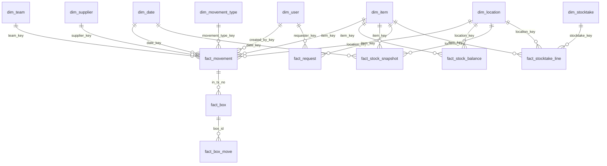

# Thiết kế lại database SEC WH: mô hình chiều (star schema)

Bản nháp để duyệt. Quyết định đã chốt:

- Giữ **Google Sheets**, chuẩn hóa lại, giữ dữ liệu cũ, **chuyển dần**.
- Thiết kế theo **mô hình chiều** (dimensions và facts) để sau này làm báo cáo, BI, hoặc chuyển BigQuery không phải đổi mô hình.
- **Tồn kho theo từng địa điểm**: hạt (grain) của bảng tồn kho là SKU × địa điểm.

**Quy mô thật (do bạn cung cấp ngày 2026-10-26):** `Database` hơn 600 dòng, `BoxDetail` 80, `BoxMove` 33, tăng rất chậm. Dữ liệu này nhỏ, nên: (a) trần 10 triệu ô của Sheets không phải mối lo trong nhiều năm; (b) việc chuyển dữ liệu là chạy một lần và đối chiếu được từng dòng bằng mắt; (c) mục tiêu chính của thiết kế là **toàn vẹn dữ liệu và dễ mở rộng**, chứ không phải tốc độ theo khối lượng. Nếu app vẫn chậm với 600 dòng thì nguyên nhân là khởi động lạnh của Apps Script và số lần đọc sheet mỗi request, không phải độ lớn dữ liệu (xem mục 6, việc 1).

## 1. Hiện trạng và điểm yếu (đã đối chiếu code)

| # | Vấn đề | Bằng chứng |
|---|---|---|
| 1 | Khóa là **số dòng**. `BoxDetail`, `BoxMove`, `Photos`, `StocktakeLine` trỏ tới `Database` bằng số dòng; xóa một dòng phải dời tham chiếu ở 4 sheet. | `admin/Delete.js` `delShiftRefs_()`; `config/Schema.js` `B.TX_ROW`, `BM.TX_ROW` |
| 2 | Sổ cái **lặp thuộc tính hàng hóa** (tên, nhóm, đơn vị, biến thể, event, bộ phận) dù đã có sheet `SKU`. Đổi tên SKU thì lịch sử lệch. | `config/Schema.js` `C.*` (21 cột) |
| 3 | **Không có bảng tồn kho.** Tồn là tổng cộng dồn cả sổ cái; mỗi request quét `Database` 3-6 lần. | `data/Transactions.js` `readAllRows_()`, `computeLeanPayload_()` |
| 4 | Xóa mềm bằng cách **dời dòng** sang `Database_Deleted`. | `admin/Delete.js` |
| 5 | `PendingRequests` 26 cột, sao chép gần hết cột sổ cái. | `config/Schema.js` `P.*` |
| 6 | Thông báo lưu số lượng dạng chữ, không có khóa tới đối tượng gây ra. | `N.QTY`, `bigquery/BqSchema.js` |
| 7 | Không có ràng buộc dữ liệu; kiểm tra rải rác (`requireKnownLoc_`, `requireKnownCat_`). | `data/Catalog.js` |

Repo đã có `bigquery/BqSchema.js` với khóa ổn định `tx_no`. Thiết kế dưới đây giữ `tx_no` làm khóa của sổ cái nên sau này chuyển BigQuery chỉ là chép bảng.

## 2. Mô hình chiều

Quy ước:

- Tên sheet: `dim_*` cho chiều, `fact_*` cho bảng sự kiện, `op_*` cho bảng vận hành không phân tích, `meta` cho bộ đếm.
- Mỗi chiều có **khóa thay thế** `*_key` (số nguyên, tự tăng, không bao giờ tái dùng, không phải số dòng) và **khóa nghiệp vụ** (`sku`, `location_code`...). Facts chỉ lưu `*_key`.
- Dòng `*_key = 0` ở mọi chiều là "Không xác định" (Unknown), để fact không bao giờ có khóa trống.
- Ngày dùng `date_key` dạng `YYYYMMDD`.

### 2.1 Các chiều (dimensions)

| Bảng | Khóa | Thuộc tính | Loại thay đổi |
|---|---|---|---|
| **dim_item** | `item_key`; nghiệp vụ `sku` | `product_no`, `name`, `variant`, `category`, `sub_category`, `event`, `unit`, `team_key`, `pic_user_key`, `active`, `valid_from`, `valid_to`, `is_current` | **SCD loại 2** cho `name`, `category`, `sub_category`, `team_key`, `pic_user_key`: đổi bộ phận hay PIC thì thêm dòng mới, dòng cũ đóng `valid_to`. Giữ được "lúc đó hàng thuộc bộ phận nào". Nguồn: sheet `SKU` hiện có. |
| **dim_location** | `location_key`; nghiệp vụ `location_code` (nguyên chuỗi trong sheet `Location`) | `site_type` (Warehouse \| Main Office \| Hub \| 3rd party \| Agency), `city`, `site_name`, `holds_stock` (TRUE cho nơi giữ hàng), `active` | Loại 1 (ghi đè). Nguồn: sheet `Location` (57 giá trị dạng "Loại - Thành phố - Tên", tách ra thành thuộc tính để báo cáo theo loại hoặc thành phố). Dòng `0` = "Không xác định". |
| **dim_bin** | `bin_key`; nghiệp vụ (`location_key`, `bin_code`) | `shelf`, `level`, `active` | Loại 1. Mỗi địa điểm có bin `UNASSIGNED`. Nguồn: cột `Bin Location`. |
| **dim_team** | `team_key`; nghiệp vụ `team_code` | `department`, `cost_centre`, `active` | Loại 1. Gom `Department` và `Cost Center` đang rải nhiều nơi. |
| **dim_user** | `user_key`; nghiệp vụ `email` | `username`, `team_key`, `role`, `notify_email`, `active` | Loại 1. Nguồn: sheet `Team`. |
| **dim_supplier** | `supplier_key`; nghiệp vụ `supplier_name` | `active` | Loại 1. Nguồn: cột `Supplier`, hiện là chữ tự do. |
| **dim_movement_type** | `movement_type_key` | `code` (IN \| OUT \| ADJ_IN \| ADJ_OUT \| TRANSFER_IN \| TRANSFER_OUT), `direction` (+1 \| -1), `label_vi`, `label_en` | Tĩnh. Hai mã TRANSFER có sẵn trong bảng nhưng **giao diện chưa dùng** (chuyển kho chưa cần). |
| **dim_date** | `date_key` (YYYYMMDD) | `date`, `year`, `quarter`, `month`, `week_iso`, `day_of_week`, `is_weekend`, `fiscal_period` | Tĩnh, tạo một lần cho 2020-2035 (khoảng 5.800 dòng). |
| **dim_stocktake** | `stocktake_key` | `stocktake_code`, `name`, `scope_location_key`, `status`, `started_at`, `closed_at`, `created_by_key` | Loại 1. Nguồn: sheet `Stocktake`. |

### 2.2 Các bảng sự kiện (facts)

**fact_movement**: *sự kiện giao dịch*, thay `Database`. Hạt: **một dòng nhập, xuất hoặc điều chỉnh của một SKU tại một địa điểm trong một ngày**. Chỉ ghi thêm.

| Cột | Ghi chú |
|---|---|
| `tx_no` | Khóa chính, số nguyên tăng dần cấp từ bộ đếm trong `meta`, không tái dùng. Giữ nguyên `No` của dữ liệu cũ. |
| `date_key`, `item_key`, `location_key`, `destination_key`, `bin_key`, `team_key`, `movement_type_key`, `supplier_key`, `created_by_key` | Khóa chiều. **`location_key` là nơi giữ hàng** (nơi cất khi nhập, nơi lấy hàng đi khi xuất) và là chiều của tồn kho. **`destination_key` là nơi nhận** (chỉ giao dịch xuất, dùng lại `dim_location` theo vai trò khác; `0` khi không áp dụng). |
| `qty` | Luôn dương. `qty_signed = qty × direction` tính khi đọc, không lưu hai lần. |
| `unit_cost`, `amount`, `box_count` | Số đo (`amount = qty × unit_cost`). |
| Chiều suy biến (degenerate) | `po_no`, `invoice_no`, `ref_type` (REQUEST \| DIRECT \| STOCKTAKE), `ref_id`. |
| Cờ dữ liệu cũ | `date_estimated` (ngày suy ra từ dòng liền trước), `location_inferred` (nơi giữ hàng được suy ra từ lịch sử, không phải giá trị gốc), `legacy_row` (số dòng gốc trong `Database`, chỉ để đối soát). |
| Vòng đời | `created_at`, `status` (ACTIVE \| VOID), `void_at`, `void_by_key`, `void_reason`. Xóa mềm là đổi `status`, **không dời dòng**. |

**fact_stock_balance**: *tồn kho hiện tại*, bảng suy ra dựng lại được từ `fact_movement`. Hạt: **SKU × địa điểm**.

| Cột | Ghi chú |
|---|---|
| `item_key`, `location_key` | Khóa chính ghép. Dùng khóa bền của hàng (dòng `is_current`), không dùng phiên bản cũ. |
| `qty_on_hand`, `boxes_left`, `qty_in_total`, `qty_out_total` | Số đo. |
| `last_in_date_key`, `last_out_date_key`, `bin_key`, `updated_at` | Mốc và bin của lần nhập gần nhất. |

Cập nhật **trong cùng khóa** với mỗi lần ghi `fact_movement`. Đây là bảng Trang chủ và trang Kho đọc, thay cho việc quét sổ cái.

**fact_stock_snapshot**: *ảnh chụp định kỳ*. Hạt: **SKU × địa điểm × cuối tháng** (tùy chọn thêm cuối ngày). Trigger đóng sổ ghi một dòng cho mỗi cặp có tồn. Dùng cho báo cáo "tồn cuối kỳ", so sánh theo tháng, và là điểm tựa để lưu trữ sổ cái theo năm.

**fact_box** *(thay `BoxDetail`)* và **fact_box_move** *(thay `BoxMove`)*: theo dõi thùng. `fact_box`: `box_id` PK, `item_key`, `location_key`, `bin_key`, `in_tx_no`, `box_no`, `qty_in`, `qty_left`, `note`. `fact_box_move`: `move_id` PK, `box_id`, `out_tx_no`, `date_key`, `qty`, `user_key`. Tham chiếu bằng `tx_no`, không bằng số dòng.

**fact_request** *(thay `PendingRequests`)*: *sự kiện tích lũy*, một dòng cho mỗi yêu cầu và được cập nhật qua vòng đời. `request_id` PK, `submitted_date_key`, `decided_date_key`, `requester_key`, `decided_by_key`, `item_key`, `location_key`, `movement_type_key`, `qty`, `unit_cost`, `po_no`, `invoice_no`, `supplier_key`, `box_count`, `status` (PENDING \| APPROVED \| REJECTED \| CANCELLED), `decision_note`, `ledger_tx_no` (điền khi duyệt), `hours_to_decide`.

**Yêu cầu nhập hàng chưa có SKU** (đã đọc `Requests.js`: staff chọn `code` có sẵn, hoặc để trống và gõ nhóm, phân nhóm, tên, biến thể, event, đơn vị của hàng mới): với yêu cầu loại này `item_key = 0` (Unknown) cho tới khi duyệt, và `fact_request` mang thêm các cột **`proposed_name`, `proposed_category`, `proposed_sub_category`, `proposed_variant`, `proposed_event`, `proposed_unit`** (trống khi chọn SKU có sẵn). Khi admin duyệt: tìm `dim_item` có cùng (bộ phận, nhóm, phân nhóm, tên, biến thể, event) thì dùng lại, không có thì tạo SKU mới (quy tắc trong `sku/Sku.js`), rồi ghi `item_key` và `ledger_tx_no` vào dòng yêu cầu. Cách này bỏ được 6 cột chép thuộc tính hàng ở yêu cầu đã có SKU mà vẫn giữ được yêu cầu hàng mới.

**fact_stocktake_line** *(thay `StocktakeLine`)*: hạt **đợt kiểm kê × SKU × địa điểm**. `stocktake_key`, `item_key`, `location_key`, `system_qty`, `counted_qty`, `variance_qty` (= đếm − hệ thống), `result` (Khớp \| Dư \| Thiếu), `adj_tx_no`.

### 2.3 Bảng vận hành (không phân tích)
- **op_notification**: `noti_id`, `created_at`, `recipient_user_key`, `kind`, `ref_type`, `ref_id`, `message`, `read_at`.
- **op_photo**: `photo_id`, `tx_no`, `drive_file_id`, `created_at`.
- **op_audit_log**: giữ như `AuditLog` hiện tại.
- **meta**: bộ đếm `tx_no`, `item_key`..., phiên bản schema, thời điểm đối soát gần nhất.

### 2.4 Ràng buộc và đối soát
Sheets không có khóa ngoại, nên:

- **Một đường ghi duy nhất** `postMovement_()` thay các đường ghi rải ở `DirectEntry`, `Approvals`, `Delete`, `Stocktake`. Hàm này kiểm tra: khóa chiều tồn tại và `active`, `qty > 0`, không làm tồn âm tại (SKU, địa điểm), rồi ghi `fact_movement`, cập nhật `fact_stock_balance`, `fact_box`, ghi `op_audit_log`, tất cả trong một `withLock_`.
- Data validation (danh sách thả xuống) trên các cột `status`, `movement_type`, `location`, `sku` của sheet.
- **Đối soát hằng đêm**: tổng `fact_movement` (ACTIVE) theo (SKU, địa điểm) phải bằng `fact_stock_balance`; tổng `qty_left` của thùng phải khớp tồn của mã theo dõi thùng. Báo lệch cho admin, không tự sửa.

## 3. Lợi ích của mô hình chiều

| Nhu cầu | Cách trả lời |
|---|---|
| Tồn kho từng địa điểm | Đọc thẳng `fact_stock_balance`. |
| Nhập/xuất theo tuần, quý, bộ phận, nhà cung cấp | Nhóm `fact_movement` theo `dim_date`, `dim_team`, `dim_supplier`. Không phải sửa schema. |
| "Lúc đó hàng thuộc bộ phận nào" | `dim_item` loại 2 giữ lịch sử. |
| Tồn cuối tháng, so sánh kỳ | `fact_stock_snapshot`. |
| Thời gian duyệt trung bình | `fact_request.hours_to_decide`. |
| Chênh lệch kiểm kê theo địa điểm | `fact_stocktake_line` nhóm theo `dim_location`. |
| Báo cáo ngoài app | Looker Studio đọc thẳng các sheet `dim_` và `fact_`, hoặc BigQuery sau này. Cùng một mô hình. |
| Thêm kho, chuyển kho | Thêm dòng ở `dim_location`; thêm `TRANSFER_IN/OUT` ở `dim_movement_type`. |

Hiệu năng: Trang chủ đọc `fact_stock_balance` (khoảng số SKU × số kho dòng) và `fact_movement` của 30 ngày gần nhất qua `date_key`, thay vì toàn bộ sổ cái.

**Giới hạn của Sheets**: tối đa 10 triệu ô mỗi spreadsheet (với `fact_movement` khoảng 20 cột, trần gần 500 nghìn giao dịch). Với hơn 600 giao dịch và tốc độ tăng chậm, bạn chưa chạm trần này trong nhiều năm. Cách xử lý khi cần được thiết kế sẵn: lưu trữ theo năm bằng `fact_stock_snapshot`, hoặc chuyển BigQuery (phân vùng `fact_movement` theo `date_key`, cluster theo `item_key`, `location_key`).

## 4. Ánh xạ từ sheet cũ

| Sheet cũ | Sang | Ghi chú |
|---|---|---|
| `Database` | `fact_movement` | Mã hàng → `item_key` qua `SKU`; `No` giữ làm `tx_no`; tên, nhóm, đơn vị... bỏ khỏi fact. |
| `Database_Deleted` | `fact_movement` với `status = VOID` | Giữ `void_*` từ `Deleted At`, `Deleted By`, `Reason`. |
| `SKU` | `dim_item` | Thêm `item_key`, `valid_from`, `valid_to`, `is_current`. |
| `Location` | `dim_location` | Thêm khóa. |
| `Category`, `Department`, `Team` | `dim_item` (nhóm), `dim_team`, `dim_user` | |
| `BoxDetail`, `BoxMove` | `fact_box`, `fact_box_move` | `Tx Row` → `tx_no`. |
| `PendingRequests` | `fact_request` | Bỏ các cột lặp thuộc tính hàng. |
| `Stocktake`, `StocktakeLine` | `dim_stocktake`, `fact_stocktake_line` | `ADJ_TX_ROW` → `adj_tx_no`. |
| `Notification`, `Photos`, `AuditLog` | `op_*` | |

## 5. Kế hoạch chuyển dần (rút gọn vì dữ liệu nhỏ)

| Pha | Việc | App đổi hành vi? | Quay lại bằng |
|---|---|---|---|
| 0 | **Kiểm tra sức khỏe dữ liệu** (chỉ đọc, xem mục 6 việc 2): tồn âm, thùng lệch giao dịch, mã không có trong `SKU`, tham chiếu số dòng mồ côi, địa điểm ngoài danh mục. Có sao lưu trước. | Không | n/a |
| 1 | **Tạo sheet mới** (`dim_*`, `fact_*`, rỗng) và **chạy một lần** hàm migrate nạp từ sheet cũ. In báo cáo so từng (SKU, địa điểm): tồn mới phải bằng tồn cũ. Hàm idempotent nên chạy lại được. Với khoảng 600 dòng việc này mất vài giây. | Không | xóa sheet mới |
| 2 | **Ghi kép trong vài ngày** (mỗi lần ghi sổ cái cũ cũng ghi mô hình mới) cùng đối soát hằng đêm. Cờ `DATA_MODEL = 'v1' \| 'shadow' \| 'v2'` ở `config/Config.js`. Có thể bỏ pha này nếu bạn chấp nhận một khoảng ngừng ghi ngắn khi chuyển. | Không | đặt cờ `v1` |
| 3 | **Đọc và ghi từ mô hình mới**; sheet cũ giữ nguyên chỉ đọc vài tháng. | Có | đặt cờ về `shadow`/`v1` |
| 4 | Đóng sổ cuối tháng (`fact_stock_snapshot`). | Không | n/a |

File server phải sửa (khoảng một nửa trong 4.000 dòng): `data/Transactions.js`, `transactions/DirectEntry.js`, `requests/Approvals.js`, `requests/Requests.js`, `requests/RequestEdits.js`, `admin/Delete.js`, `inventory/Boxes.js`, `inventory/Stock.js`, `stocktake/Stocktake.js`, `transactions/Tickets.js`, `config/Schema.js`. Client gần như không đổi vì payload của `bootstrapAll` giữ nguyên hình dạng.

## 6. Quyết định và việc tiếp theo

**Đã chốt:** tồn theo từng địa điểm; staff được xin nhập hàng chưa có SKU (thiết kế ở `fact_request`); chuyển kho **chưa cần**, nhưng mô hình sẵn sàng (xem demo `~/Tools/scratch/dbdemo/demo.js`).

**Mặc định tạm cho bin (bạn chưa quyết):** hạt tồn là **SKU × địa điểm**; `bin_key` được ghi ở **mỗi dòng `fact_movement`**. Vì vậy sau này muốn tồn theo từng bin chỉ cần nhóm lại `fact_movement` theo `bin_key`, không mất dữ liệu, miễn là giao diện nhập/xuất ghi bin vào mỗi giao dịch (hiện xuất kho chưa hỏi bin). Quyết định này có thể để sau.

**Việc tiếp theo, theo thứ tự:**
1. Đo nguyên nhân chậm: mở app, mở Console của trình duyệt và gửi dòng `[perf] server {...}` (có `authMs`, `configMs`, `dataMs`, `pendingMs`). Với 600 dòng, nếu `dataMs` nhỏ thì việc chậm nằm ở nơi khác và đổi mô hình dữ liệu không làm nhanh hơn.
2. Pha 0 (chẩn đoán dữ liệu, chỉ đọc) rồi Pha 1 (tạo sheet và migrate một lần).

## 7. Kết quả Pha 0 trên dữ liệu thật (2026-10-26)

`Database` 644 · `BoxDetail` 79 · `BoxMove` 32 · `Photos` 12 · `PendingRequests` 85 · **`SKU` 0**.

| Kết quả | Ý nghĩa cho thiết kế |
|---|---|
| **Sheet `SKU` rỗng**, cả 644 dòng sổ cái có mã không có trong `SKU`; 83/85 yêu cầu đã duyệt cũng vậy. Code không có hàm nạp từ mã cũ (cột `Legacy Code` tồn tại nhưng chưa ai điền). | `dim_item` phải **dựng từ sổ cái**, giữ nguyên mã cũ làm `sku`. Theo `auth/Access.js`, staff chỉ thấy mã có trong `SKU`, nên **hiện staff có thể không thấy hàng nào**: cần kiểm tra ngay, không chờ migrate. |
| Không có tồn âm theo mã (L11 sạch); cùng một mã luôn có cùng tên, nhóm, đơn vị (L9 sạch). | Thuộc tính hàng suy ra từ sổ cái đáng tin; tổng tồn theo mã đúng. |
| **484/644 dòng có địa điểm ngoài danh mục `Location`**: nhiều dòng để **trống**, nhiều dòng ghi dạng dài ("Main Office - Ho Chi Minh - Mapletree F15/F16/F18"). 39 cặp (mã, địa điểm) bị **tồn âm**. | Tồn theo địa điểm không thể suy trực tiếp từ lịch sử. Cần chuẩn hóa địa điểm trước (xem quyết định bên dưới). |
| 63 dòng không có ngày (dòng 490, 562-570...). | Cần quy tắc: dùng ngày ước lượng, hay `date_key = 0` (Unknown). |
| 7 dòng dùng đơn vị Set, Piece, Pack (code chỉ cho Each/Box/Bag). | `dim_item.unit` nên là danh sách mở, hoặc ánh xạ. |
| **48/79 thùng và 7/32 lần lấy thùng trỏ sai dòng sổ cái** (đúng loại lỗi số dòng đã nêu ở mục 1). | Phải dựng lại liên kết bằng (mã, loại, tổng số lượng). Báo cáo chi tiết `auditBeforeRedesignDetail()` cho biết sửa được chắc chắn bao nhiêu. |
| 567/644 dòng nhập thiếu PO, hóa đơn, nhà cung cấp hoặc giá. | Cho phép NULL ở `fact_movement` với dữ liệu cũ; app vẫn bắt buộc với giao dịch mới. |

Bước tiếp theo: chạy `auditBeforeRedesignDetail()` (địa điểm thực tế, dòng thiếu ngày, tồn âm có chỗ bù không, độ lệch số dòng của thùng), rồi chốt quy tắc migrate.

## 8. Quy tắc migrate đã chốt (2026-10-26)

Dựa trên báo cáo chi tiết: sheet `Location` đã đủ (57 giá trị); sổ cái dùng 7 giá trị khác nhau, trong đó **483 dòng để trống** và **Warehouse - Ho Chi Minh - SEC là nơi duy nhất thật sự có dư**. Mọi cặp tồn âm (39/39) đều có chỗ dư ở Warehouse SEC, tức là các nơi như Mapletree F15, F18, CMC F5, Agency vốn là **nơi nhận hàng** bị ghi vào cột địa điểm.

| # | Quy tắc | Chi tiết |
|---|---|---|
| R1 | **Địa điểm có hai nghĩa tùy giao dịch** | Thêm `destination_key` cạnh `location_key` (mục 2.2). Tồn kho chỉ tính theo `location_key`. |
| R2 | **Phân loại dòng xuất cũ bằng số dư chạy**, xử lý lần lượt theo thứ tự dòng | Dòng xuất tại địa điểm L, số lượng q: nếu số dư (mã, L) tại thời điểm đó ≥ q thì L là **nơi giữ hàng**. Ngược lại, tìm nơi khác của cùng mã còn đủ ≥ q (ưu tiên số dư lớn nhất): nơi đó là `location_key` (`location_inferred = TRUE`) và L chuyển thành `destination_key`. Không nơi nào đủ thì giữ nguyên và đưa vào danh sách rà soát. Mọi dòng bị phân loại lại được in ra để bạn xem trước khi chạy thật. |
| R3 | **Địa điểm trống → "Không xác định"** (`location_key = 0`) | Không đoán. Báo cáo tồn có một mục "Không xác định" cho các mã cũ, admin phân bổ dần. |
| R4 | **63 dòng nhập thiếu ngày** (dòng 490, 562, 565-603, 605-606, 617-636) | Lấy ngày của dòng có ngày liền trước; `date_estimated = TRUE`. Cần kiểm lại: dòng 561 và 637 có ngày hợp lý không. |
| R5 | **Đơn vị** | Chuẩn hóa bộ đơn vị theo yêu cầu của bạn, ví dụ Each → Piece (xem mục "Chưa chốt" bên dưới). Đổi trong `dim_item.unit`; code kiểm tra đơn vị (`UNITS` ở `config/Config.js` và thông báo lỗi ở `Requests.js`) đổi ở pha chuyển sang đọc/ghi mô hình mới. |
| R6 | **`dim_item` dựng từ sổ cái** vì sheet `SKU` rỗng | 578 mã khác nhau (544 dạng `TEAM_...`, 19 dạng mới `-GIV-`, 15 dạng khác). Giữ nguyên mã cũ làm `sku`; thuộc tính lấy từ dòng đầu tiên của mã (không có mã nào bị lệch thuộc tính); bộ phận lấy từ Cost Center qua `Department` (26 Cost Center). |
| R7 | **Dựng lại liên kết thùng** bằng (mã, loại, tổng số lượng) | `BoxDetail`: 16 nhóm, 7 đúng sẵn, 9 sửa được (lệch +5 ở 8 nhóm, −1 ở 1 nhóm), 0 mơ hồ. `BoxMove`: 22 nhóm, 15 đúng sẵn, 7 cần xem. Bản kiểm tra ban đầu chưa phát hiện trường hợp hai nhóm cùng nhắm một dòng sổ cái (đã vá); các trường hợp đó và 2 nhóm "không tìm thấy" vào **danh sách rà soát tay**. |
| R8 | **Dòng nhập thiếu PO, hóa đơn, nhà cung cấp, giá** (567 dòng) | Cho phép NULL với dữ liệu cũ; giao dịch mới vẫn bắt buộc. |

**Chưa chốt:**
1. **Bộ đơn vị cuối cùng.** Bạn nêu "Each → Piece". Tôi hiểu là chuẩn hóa về **Piece, Pack, Set, Box, Bag** (Each biến mất, 639 dòng đổi sang Piece). Cần bạn xác nhận danh sách này, vì giao diện nhập kho cũng sẽ hiện "Piece" thay "Each".
2. Form xuất kho cần **hai ô**: "Lấy từ (nơi giữ hàng)" bắt buộc, và "Giao tới (nơi nhận)" tùy chọn. Làm ở pha chuyển sang mô hình mới.

## 9. Trạng thái triển khai

| Bước | File / hàm | Trạng thái |
|---|---|---|
| Pha 0 | `server/admin/DbAudit.js`: `auditBeforeRedesign()`, `auditBeforeRedesignDetail()` | Đã chạy trên dữ liệu thật |
| Pha 1.1 | `server/admin/DbMigrate.js`: `migrateDryRun()` (chỉ tính, in báo cáo) | Đã viết; chờ bạn chạy và duyệt báo cáo |
| Pha 1.2 | `migrateWrite()` tạo `dim_date`, `dim_location`, `dim_team`, `dim_item`, `dim_movement_type`, `fact_movement`, `fact_stock_balance`, `fact_box`, `fact_box_move`, `meta`; `migrateReset()` xóa riêng các sheet đó | Đã viết, đã thử trên giả lập; chưa chạy trên dữ liệu thật |
| Chưa làm | `dim_user`, `dim_supplier`, `dim_bin`, `dim_stocktake`, `fact_request`, `fact_stocktake_line`, `fact_stock_snapshot`, `op_*` | Làm ở các bước sau. Tạm thời `fact_movement` giữ `bin` và `supplier` dạng chữ. |
| Pha 2-3 | Ghi kép, rồi đọc từ mô hình mới | Chưa bắt đầu; đây là bước đầu tiên app thay đổi hành vi |
